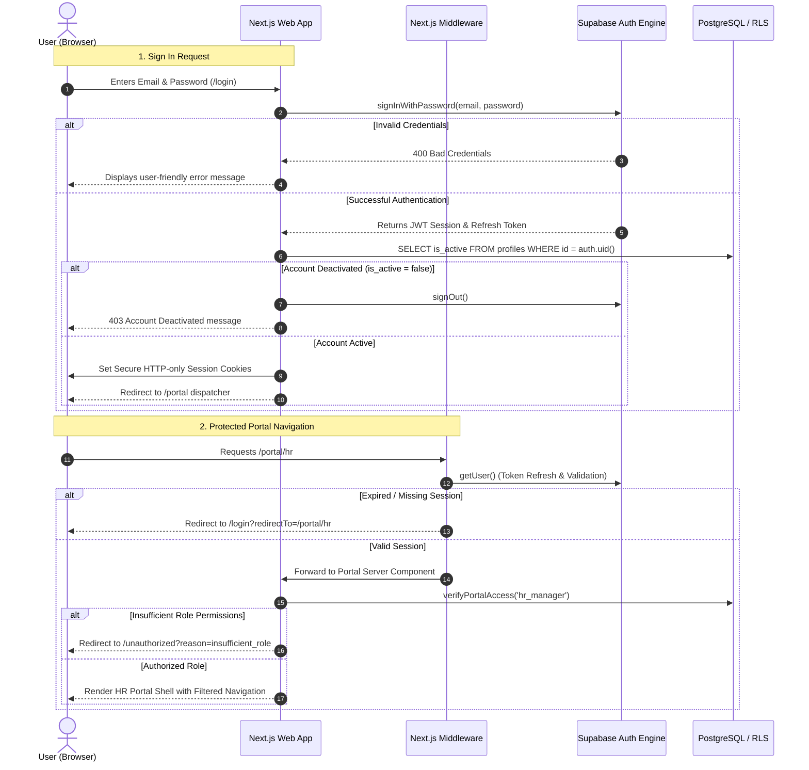

# EMS — Authentication, RBAC and Secure Access Documentation

**Project Identity:**

- **Institution:** GIET Polytechnic College
- **Department:** Artificial Intelligence (AI) Department
- **Batch:** 2024–2027
- **Project:** Employee Management System (EMS)
- **Team:** T-1
- **Project Category:** Industrial Training Project
- **Publisher ID:** `GIETP-AI-IT-EMS-T1-2026`
- **Phase:** 3 — Authentication, RBAC & Secure Access

---

## 1. Authentication Flow Diagram



---

## 2. RBAC Role-Permission Matrix

The Employee Management System establishes **10 distinct portal roles** governed by the **Least Privilege Principle**. No portal receives permissions merely because an interface tab exists.

| Granular Permission Code | Super Admin | Org Admin | HR  | Recruitment | Finance & Payroll | Manager | Dept Head | IT & Assets | Employee (Self) | Auditor (Read-Only) |
| ------------------------ | :---------: | :-------: | :-: | :---------: | :---------------: | :-----: | :-------: | :---------: | :-------------: | :-----------------: |
| `organization.read`      |     ✅      |    ✅     | ✅  |     ✅      |        ✅         |   ✅    |    ✅     |     ✅      |       ✅        |         ✅          |
| `organization.write`     |     ✅      |    ✅     | ❌  |     ❌      |        ❌         |   ❌    |    ❌     |     ❌      |       ❌        |         ❌          |
| `employee.read`          |     ✅      |    ✅     | ✅  |     ✅      |        ✅         |   ✅    |    ✅     |     ✅      |       ❌        |         ✅          |
| `employee.write`         |     ✅      |    ✅     | ✅  |     ❌      |        ❌         |   ❌    |    ❌     |     ❌      |       ❌        |         ❌          |
| `attendance.self`        |     ✅      |    ✅     | ✅  |     ❌      |        ❌         |   ✅    |    ✅     |     ❌      |       ✅        |         ❌          |
| `attendance.read`        |     ✅      |    ✅     | ✅  |     ❌      |        ❌         |   ✅    |    ✅     |     ❌      |       ❌        |         ✅          |
| `attendance.manage`      |     ✅      |    ✅     | ✅  |     ❌      |        ❌         |   ✅    |    ✅     |     ❌      |       ❌        |         ❌          |
| `leave.self`             |     ✅      |    ✅     | ✅  |     ❌      |        ❌         |   ✅    |    ✅     |     ❌      |       ✅        |         ❌          |
| `leave.read`             |     ✅      |    ✅     | ✅  |     ❌      |        ❌         |   ✅    |    ✅     |     ❌      |       ❌        |         ✅          |
| `leave.approve`          |     ✅      |    ✅     | ✅  |     ❌      |        ❌         |   ✅    |    ✅     |     ❌      |       ❌        |         ❌          |
| `payroll.read`           |     ✅      |    ✅     | ❌  |     ❌      |        ✅         |   ❌    |    ❌     |     ❌      |       ❌        |         ✅          |
| `payroll.write`          |     ✅      |    ❌     | ❌  |     ❌      |        ✅         |   ❌    |    ❌     |     ❌      |       ❌        |         ❌          |
| `payroll.approve`        |     ✅      |    ❌     | ❌  |     ❌      |        ✅         |   ❌    |    ❌     |     ❌      |       ❌        |         ❌          |
| `recruitment.read`       |     ✅      |    ✅     | ✅  |     ✅      |        ❌         |   ❌    |    ❌     |     ❌      |       ❌        |         ❌          |
| `recruitment.write`      |     ✅      |    ❌     | ❌  |     ✅      |        ❌         |   ❌    |    ❌     |     ❌      |       ❌        |         ❌          |
| `asset.read`             |     ✅      |    ✅     | ❌  |     ❌      |        ❌         |   ❌    |    ✅     |     ✅      |       ❌        |         ✅          |
| `asset.manage`           |     ✅      |    ✅     | ❌  |     ❌      |        ❌         |   ❌    |    ❌     |     ✅      |       ❌        |         ❌          |
| `document.read`          |     ✅      |    ✅     | ✅  |     ✅      |        ✅         |   ❌    |    ✅     |     ❌      |       ✅        |         ✅          |
| `document.write`         |     ✅      |    ✅     | ✅  |     ❌      |        ❌         |   ❌    |    ❌     |     ❌      |       ❌        |         ❌          |
| `report.read`            |     ✅      |    ✅     | ✅  |     ✅      |        ✅         |   ✅    |    ✅     |     ✅      |       ❌        |         ✅          |
| `audit.read`             |     ✅      |    ✅     | ❌  |     ❌      |        ❌         |   ❌    |    ❌     |     ❌      |       ❌        |         ✅          |
| `role.manage`            |     ✅      |    ✅     | ❌  |     ❌      |        ❌         |   ❌    |    ❌     |     ❌      |       ❌        |         ❌          |

---

## 3. Row Level Security (RLS) Policy Summary

All 12 application tables enforce PostgreSQL Row Level Security:

1. **`organizations`**:
   - `SELECT`: Members of the organization (`is_org_member(id)`).
   - `INSERT / UPDATE / DELETE`: Denied to standard clients. Organization provisioning is strictly reserved for the privileged service role.
2. **`profiles`**:
   - `SELECT`: Permitted for own profile (`id = auth.uid()`) OR fellow organization members (`is_org_member(organization_id)`).
   - `UPDATE`: Permitted for own non-sensitive profile fields. Trigger `prevent_profile_org_self_change` blocks altering `organization_id`.
   - `INSERT`: Denied (created automatically via PostgreSQL trigger `on_auth_user_created`).
3. **`employees`**:
   - `SELECT`: Permitted for self (`profile_id = auth.uid()`), reporting manager (`is_manager_of_employee(id)`), or organizational actors holding `employee.read`.
   - `INSERT / UPDATE / DELETE`: Restricted to organization members holding `employee.write`.
4. **`roles` & `permissions`**:
   - `roles SELECT`: System roles (`organization_id IS NULL`) or current organization roles.
   - `permissions SELECT`: Read permitted to all authenticated users.
   - Role creation and permissions grant restricted to `role.manage`.
5. **`user_roles`**:
   - Trigger `prevent_self_role_assignment_trigger` strictly prohibits users from assigning or elevating roles to themselves (`auth.uid() = profile_id`).
   - Assignment requires active membership and `role.manage` / `roles:assign` permission.
6. **Cross-Tenant Boundary Triggers**:
   - `enforce_employee_org_boundary()`: Guarantees branch, department, and designation assigned to an employee belong to the same `organization_id`.
   - `enforce_department_branch_org_boundary()`: Ensures branches and departments share identical tenant ownership.

---

## 4. Ten Portal Route Mappings & Shells

| Portal Role               | Base Path                 | Primary Responsibility                                                 |
| ------------------------- | ------------------------- | ---------------------------------------------------------------------- |
| `super_admin`             | `/portal/super-admin`     | Platform oversight, multi-tenant provisioning, global telemetry        |
| `org_admin`               | `/portal/org-admin`       | Campus/branch structure, departmental nodes, member provisioning       |
| `hr_manager`              | `/portal/hr`              | Employee master records, shifts, leave policies, change ledger         |
| `recruitment_manager`     | `/portal/recruitment`     | Job requisitions, applicant pipelines, interview panels, onboarding    |
| `finance_payroll_manager` | `/portal/finance-payroll` | Compensation structures, monthly payroll engine, tax compliance        |
| `manager`                 | `/portal/manager`         | Reporting line oversight, attendance verification, team leave sign-off |
| `dept_head`               | `/portal/dept-head`       | Academic/corporate department staffing, resource allocation            |
| `it_assets_manager`       | `/portal/it-assets`       | Hardware inventory, device checkout, license seat monitoring           |
| `employee`                | `/portal/employee`        | Self-service profile, punch clock, leave requests, payslip access      |
| `auditor`                 | `/portal/auditor`         | Read-only compliance trail, change ledgers, security log inspection    |

---

## 5. Security & Verification Test Report

Automated tests run via Vitest (`pnpm test`):

```
✓ tests/security-guards.test.ts (13 tests)
✓ tests/rbac-matrix.test.ts (13 tests)
✓ tests/auth-validation.test.ts (12 tests)

Test Files:  3 passed (3)
Tests:       38 passed (38)
Duration:    497ms
```

### Coverage Highlights:

- **Authentication input validation:** Email formats, password complexity constraints (min 8 chars, uppercase, lowercase, digit).
- **Password recovery & reset:** Mismatched password rejection, valid email acceptance.
- **RBAC Matrix integrity:** All 10 roles verified against 22 granular permissions.
- **Auditor read-only boundary:** Verified that `auditor` cannot access any write, approve, or manage permissions.
- **Payroll isolation:** Verified that payroll write/approve permissions are restricted exclusively to `finance_payroll_manager` and `super_admin`.
- **Open redirect protection:** Verified that external URLs (`https://evil.com`), protocol-relative URLs (`//evil.com`), and backslashes are sanitized to safe internal fallbacks.
- **Account status check:** Verified that inactive accounts (`is_active = false`) are rejected from entering portal routes.
- **Privilege escalation prevention:** Verified that employee roles cannot access administrative or management portals.
