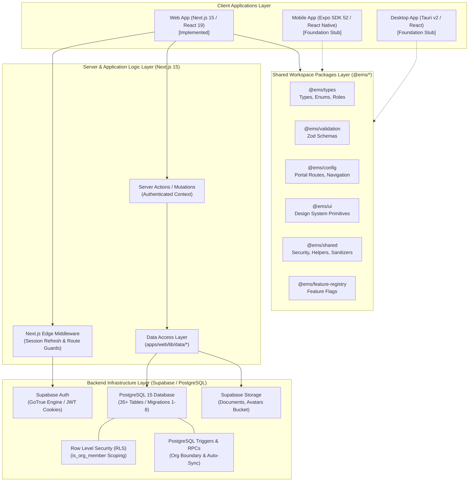

# 01 — High-Level System Architecture

**Project:** Employee Management System (EMS)  
**Institution:** GIET Polytechnic College | Artificial Intelligence (AI) Department | Batch 2024–2027  
**Team:** T-1 | **Publisher ID:** GIETP-AI-IT-EMS-T1-2026 | **Version:** 1.0.0

---

## Architecture Diagram

### Legend & Notes
- **Solid lines:** Fully implemented and verified in v1.0.0.
- **Dashed lines:** Multi-platform foundation code referencing shared workspace libraries.
