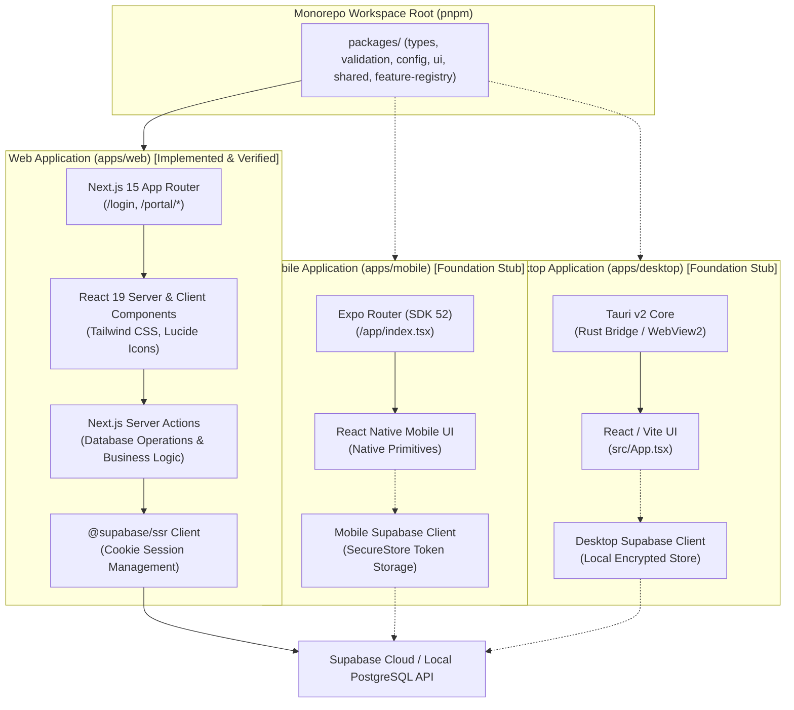

# 02 — Multi-Platform Application Architecture

**Project:** Employee Management System (EMS)  
**Institution:** GIET Polytechnic College | Artificial Intelligence (AI) Department | Batch 2024–2027  
**Team:** T-1 | **Publisher ID:** GIETP-AI-IT-EMS-T1-2026 | **Version:** 1.0.0

---

## Diagram: Web, Android, and Windows Architecture

### Platform Maturity Matrix
- **Web (`apps/web`):** Complete, fully integrated with all 10 role portals, SSR session guards, 34 compiled production routes.
- **Mobile (`apps/mobile`):** Architectural foundation stub with Expo SDK 52 and React Native project references to shared packages.
- **Desktop (`apps/desktop`):** Architectural foundation stub with Tauri v2 configuration and React / Vite project references to shared packages.
