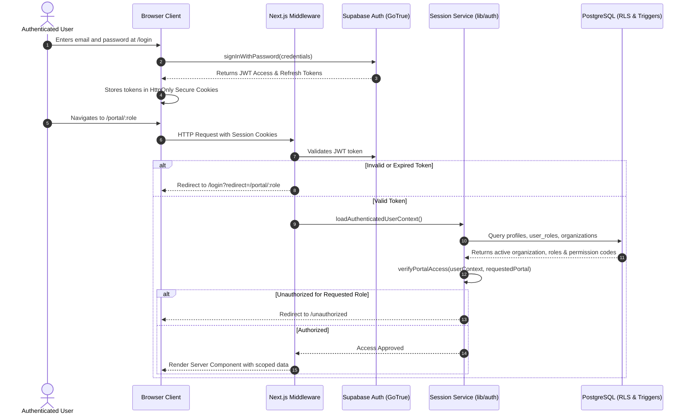

# 03 — Authentication and Authorization Flow

**Project:** Employee Management System (EMS)  
**Institution:** GIET Polytechnic College | Artificial Intelligence (AI) Department | Batch 2024–2027  
**Team:** T-1 | **Publisher ID:** GIETP-AI-IT-EMS-T1-2026 | **Version:** 1.0.0

---

## Authentication and RBAC Flow

### Key Security Gates
1. **HttpOnly Cookies:** Prevents XSS token exfiltration.
2. **`verifyPortalAccess()`:** Restricts portal access strictly to mapped roles.
3. **Database RLS:** Even if UI routing was bypassed, Postgres blocks data retrieval outside `is_org_member(organization_id)`.
