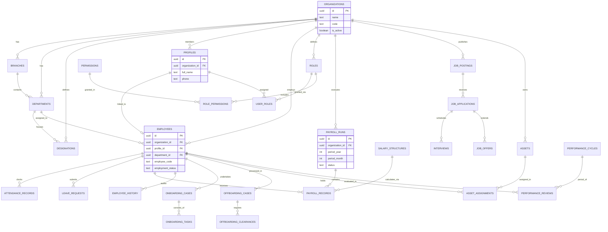

# 04 — Database Entity-Relationship (ER) Diagram

**Project:** Employee Management System (EMS)  
**Institution:** GIET Polytechnic College | Artificial Intelligence (AI) Department | Batch 2024–2027  
**Team:** T-1 | **Publisher ID:** GIETP-AI-IT-EMS-T1-2026 | **Version:** 1.0.0

---

## Core Schema ER Diagram

### Schema Notes
- All tables feature UUID primary keys generated by `gen_random_uuid()`.
- All operational tables contain foreign key `organization_id` strictly referencing `organizations(id)`.
- RLS policies on all tables filter records by `is_org_member(organization_id)`.
