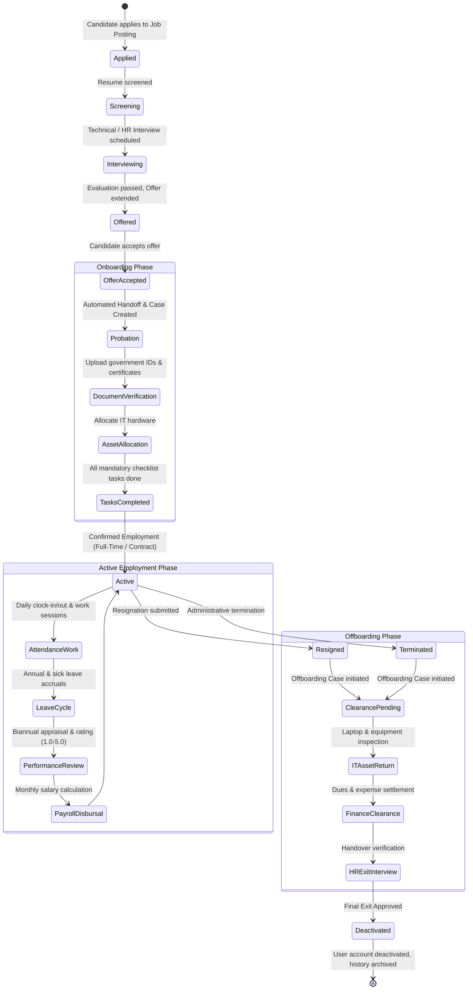

# 05 — Employee Lifecycle Flow

**Project:** Employee Management System (EMS)  
**Institution:** GIET Polytechnic College | Artificial Intelligence (AI) Department | Batch 2024–2027  
**Team:** T-1 | **Publisher ID:** GIETP-AI-IT-EMS-T1-2026 | **Version:** 1.0.0

---

## State Diagram: Complete Employee Lifecycle

### Business Rules Enforced
1. **Onboarding Completion Guard:** Cannot confirm employee until 100% of required checklist tasks are marked `completed`.
2. **Offboarding Deactivation Guard:** Cannot deactivate employee profile until all departmental clearance items (IT, Finance, HR) are marked `cleared`.
