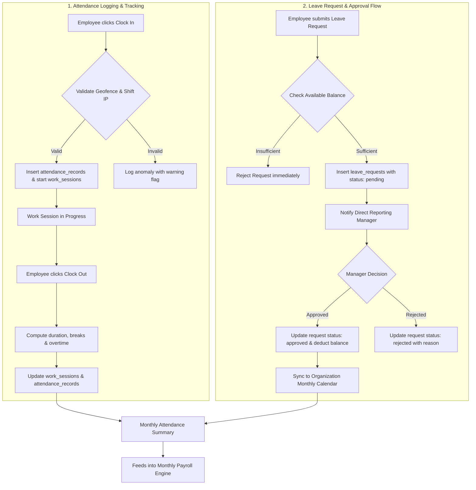

# 06 — Attendance and Leave Approval Flow

**Project:** Employee Management System (EMS)  
**Institution:** GIET Polytechnic College | Artificial Intelligence (AI) Department | Batch 2024–2027  
**Team:** T-1 | **Publisher ID:** GIETP-AI-IT-EMS-T1-2026 | **Version:** 1.0.0

---

## Attendance & Leave Workflow

### Key Validations
- **Single Active Session:** Employees cannot clock in while an active work session exists without clocking out.
- **Leave Balance Isolation:** Annual leave, sick leave, and casual leave balances are strictly tracked per employee per calendar year.
