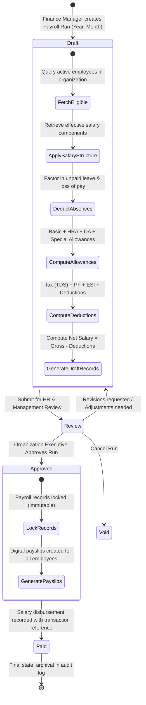

# 07 — Payroll Processing Flow

**Project:** Employee Management System (EMS)  
**Institution:** GIET Polytechnic College | Artificial Intelligence (AI) Department | Batch 2024–2027  
**Team:** T-1 | **Publisher ID:** GIETP-AI-IT-EMS-T1-2026 | **Version:** 1.0.0

---

## State & Data Flow: Monthly Payroll Run

### Idempotency & Concurrency Rules
- **Unique Period Constraint:** Unique index on `(organization_id, period_year, period_month)` guarantees no duplicate runs can be spawned.
- **Sequential Gate:** Runs cannot transition directly from `draft` to `paid` without formal `review` and `approved` sign-offs.
- **Immutable Locking:** Once status is `approved` or `paid`, individual payroll line items cannot be modified.
