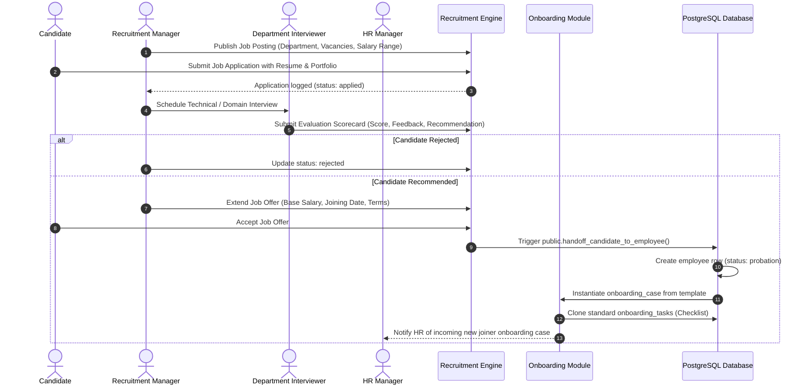

# 08 — Recruitment-to-Onboarding Flow

**Project:** Employee Management System (EMS)  
**Institution:** GIET Polytechnic College | Artificial Intelligence (AI) Department | Batch 2024–2027  
**Team:** T-1 | **Publisher ID:** GIETP-AI-IT-EMS-T1-2026 | **Version:** 1.0.0

---

## Recruitment-to-Onboarding Sequence Flow

### Automation Details
- `handoff_candidate_to_employee()` is a PostgreSQL transactional function.
- It automatically seeds standard onboarding checklist tasks (e.g. Identity Verification, IT Equipment Allocation, Bank Details, Orientation).
