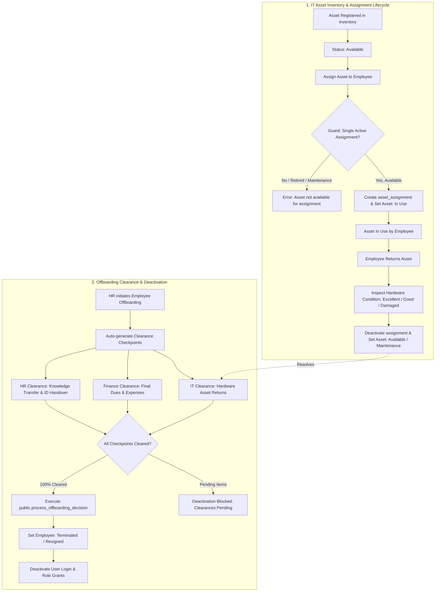

# 09 — Asset Assignment and Offboarding Flow

**Project:** Employee Management System (EMS)  
**Institution:** GIET Polytechnic College | Artificial Intelligence (AI) Department | Batch 2024–2027  
**Team:** T-1 | **Publisher ID:** GIETP-AI-IT-EMS-T1-2026 | **Version:** 1.0.0

---

## Hardware Asset Lifecycle & Offboarding Clearance Flow

### Database Guarantees
- Single active assignment constraint enforced at database level.
- `public.process_offboarding_decision()` is atomic and prevents employee deactivation if any clearances remain pending.
