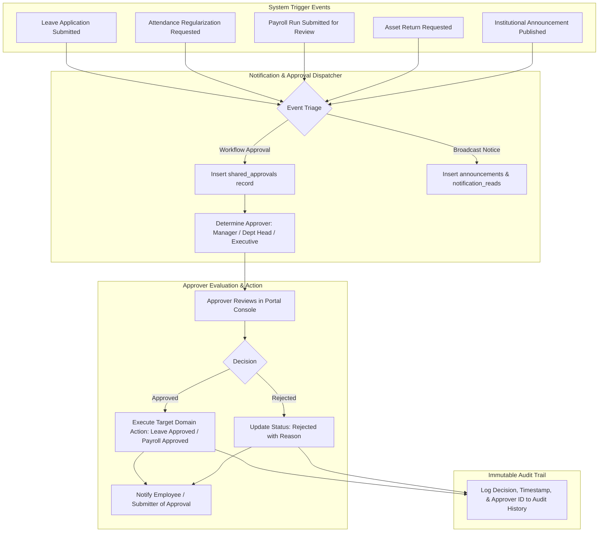

# 10 — Notification and Approval Flow

**Project:** Employee Management System (EMS)  
**Institution:** GIET Polytechnic College | Artificial Intelligence (AI) Department | Batch 2024–2027  
**Team:** T-1 | **Publisher ID:** GIETP-AI-IT-EMS-T1-2026 | **Version:** 1.0.0

---

## Notification Dispatch and Multi-Level Approvals

### Notification Types Handled
- Workflow approvals (`shared_approvals`)
- Personal notifications (`notifications`)
- Institutional announcements (`announcements`) with target audience filtering (`all`, `department`, `branch`)
