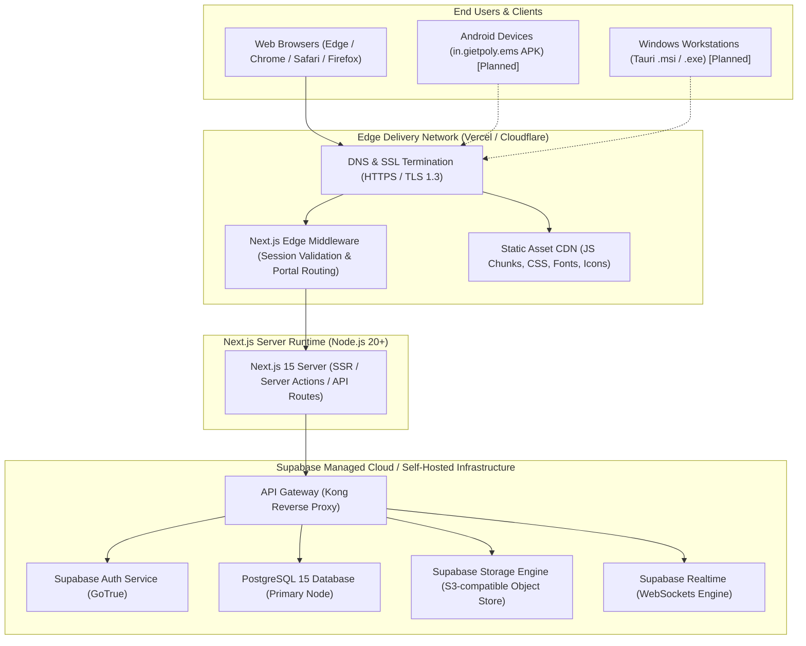

# 11 — Deployment Architecture

**Project:** Employee Management System (EMS)  
**Institution:** GIET Polytechnic College | Artificial Intelligence (AI) Department | Batch 2024–2027  
**Team:** T-1 | **Publisher ID:** GIETP-AI-IT-EMS-T1-2026 | **Version:** 1.0.0

---

## Production Deployment Topology

### Infrastructure Components
- **Hosting Tier:** Vercel / Node.js 20+ runtime for Next.js App Router.
- **Database & Storage Tier:** Supabase Cloud / Self-hosted PostgreSQL 15 with connection pooling (PgBouncer/Supavisor).
- **Security Protocols:** Strict HTTPS, HttpOnly Secure Cookies, Row Level Security (RLS).
