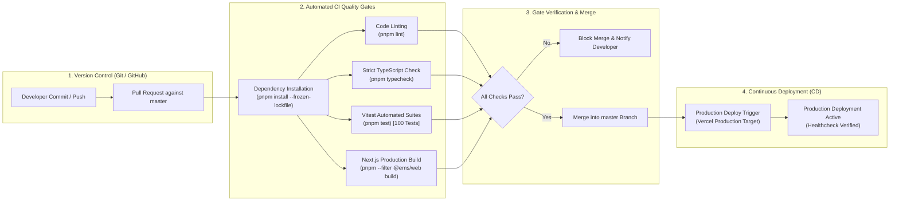

# 12 — Continuous Integration and Deployment (CI/CD) Workflow

**Project:** Employee Management System (EMS)  
**Institution:** GIET Polytechnic College | Artificial Intelligence (AI) Department | Batch 2024–2027  
**Team:** T-1 | **Publisher ID:** GIETP-AI-IT-EMS-T1-2026 | **Version:** 1.0.0

---

## CI/CD Pipeline Workflow

### Automated Quality Gate Matrix
- **`pnpm lint`:** ESLint 9 validation across all 9 workspaces.
- **`pnpm typecheck`:** TypeScript strict compiler check with 0 errors allowed.
- **`pnpm test`:** Vitest execution of 100 tests across 8 test suites.
- **`pnpm --filter @ems/web build`:** Generation of 34 optimized Next.js production routes.
